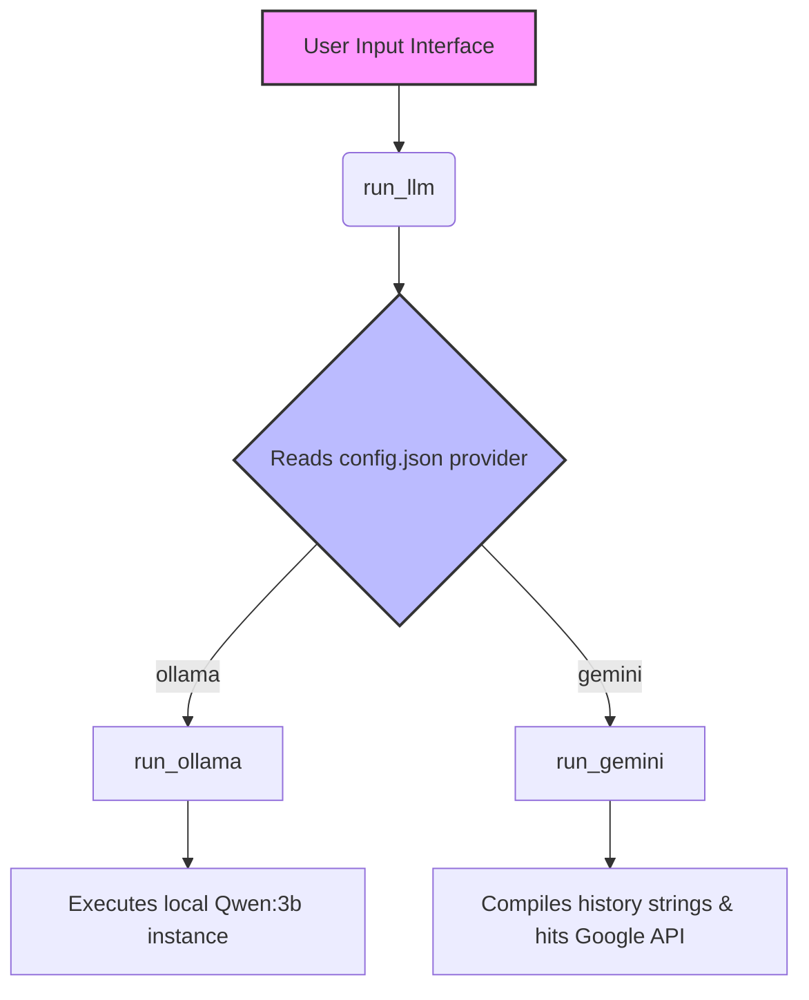

# WebWikiAlexa
Your conversational web companion. WikiWebAlexa instantly reads, summarizes, and chats about any link you share—from deep wiki articles to e-commerce product pages.

# Core.py 
### 🧱 Code Execution Flowchart

### 🛠️ Core Function Reference

* **`run_llm(history)`**  
  Acts as the main routing controller; reads `config.json` to dynamically direct the conversation history to the chosen AI provider.

* **`run_gemini(prompt)`**  
  Handles authentication and parameter configurations to generate content from remote Google Gemini API endpoints.

* **`run_ollama(prompt)`**  
  Assembles localized token constraints and executes live text inference through a local Ollama container daemon.

## 🚀 Application Execution & Launch Protocol

### Running the User Interface
* **Correct Syntax:** `uv run streamlit run src\webwikialexa\main.py`

## 📦 Production Package Ingestion Engine

### Root Application Package Tracking
* **Configuration Format:** Explicit package flag definition `package = true` under `[tool.uv]`.
* **Why it works:** Bypasses complex multi-project workspace schemas that expect multiple configuration layouts. Setting `package = true` instructs the build engine to treat the entire repository as a single-package instance, successfully resolving deep system package calls like `from src.webwikialexa.core import run_llm`.

## 🕹️ UI State Control & Application Resets

### Interactive Session State Clearing Pattern
* **Correct Syntax:** Invoking `st.rerun()` with explicit functional parameters to force thread updates.
* **State Preservation Rules:** Assigning seed text configurations utilizing `.copy()` data arrays. This enforces strict memory isolation boundaries between static initialization constants (`initialPrompt`) and active state data trackers (`st.session_state["history"]`), preventing history contamination across application resets.
