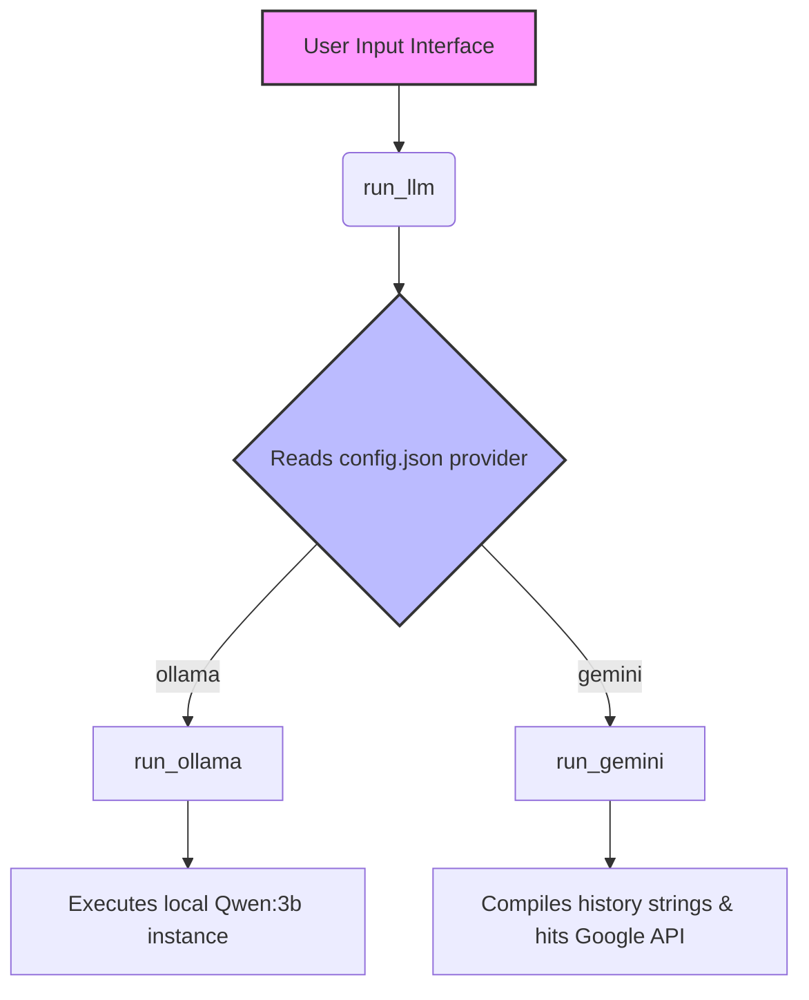
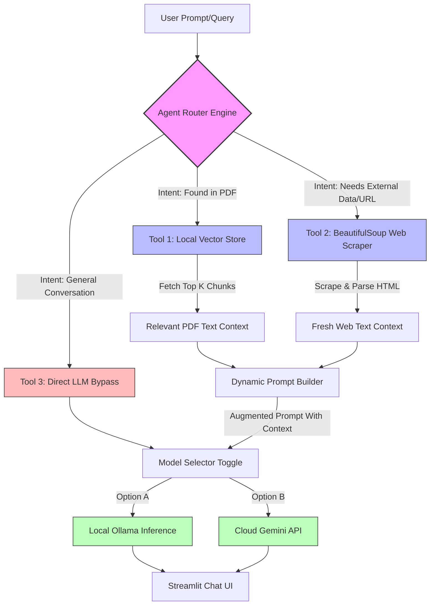
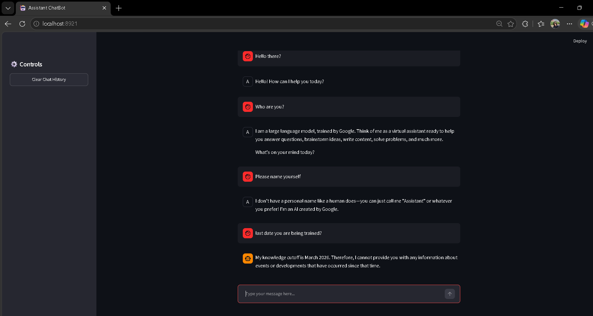
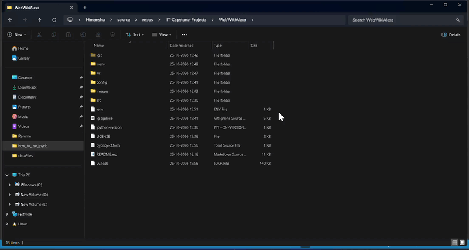

# WebWikiAlexa
Your conversational web companion. WikiWebAlexa instantly reads, summarizes, and chats about any link you share—from deep wiki articles to e-commerce product pages.

# Core.py 
### 🧱 Code Execution Flowchart



### 🛠️ Core Function Reference

* **`run_llm(history)`**  
  Acts as the main routing controller; reads `config.json` to dynamically direct the conversation history to the chosen AI provider.

* **`run_gemini(prompt)`**  
  Handles authentication and parameter configurations to generate content from remote Google Gemini API endpoints.

* **`run_ollama(prompt)`**  
  Assembles localized token constraints and executes live text inference through a local Ollama container daemon.

## 🚀 Application Execution & Launch Protocol

### Running the User Interface
* **Correct Syntax:** `uv run streamlit run src\webwikialexa\main.py`

## Configure PORt manually 
```
uv run streamlit run src\webwikialexa\main.py --server.port 8921
```

## 📦 Production Package Ingestion Engine

### Root Application Package Tracking
* **Configuration Format:** Explicit package flag definition `package = true` under `[tool.uv]`.
* **Why it works:** Bypasses complex multi-project workspace schemas that expect multiple configuration layouts. Setting `package = true` instructs the build engine to treat the entire repository as a single-package instance, successfully resolving deep system package calls like `from src.webwikialexa.core import run_llm`.

## 🕹️ UI State Control & Application Resets

### Interactive Session State Clearing Pattern
* **Correct Syntax:** Invoking `st.rerun()` with explicit functional parameters to force thread updates.
* **State Preservation Rules:** Assigning seed text configurations utilizing `.copy()` data arrays. This enforces strict memory isolation boundaries between static initialization constants (`initialPrompt`) and active state data trackers (`st.session_state["history"]`), preventing history contamination across application resets.

## This is RAG + Agentic + Chatbot

### 🏗️ Hybrid Agentic-RAG Architecture



## 📚 Project Guide (Learning Notes)

This section adds a guided tour of the current repository and its tooling. It is intended to help new contributors connect the files, the application flow, and the commands used to run the project.

### 📁 Folder Structure

```text
WebWikiAlexa/
├── config/
│   └── config.json             # Provider selection and model generation settings
├── src/
│   └── webwikialexa/
│       ├── __init__.py         # Package entry point used by the project script
│       ├── app.py              # Separate Streamlit hybrid routing/RAG prototype
│       ├── core.py             # LLM provider functions used by main.py
│       └── main.py             # Main Streamlit chat interface
├── pyproject.toml              # Project metadata, dependencies, and uv build settings
├── uv.lock                     # Exact resolved dependency versions for repeatable installs
└── README.md                   # Project overview and usage guide
```

The tree above focuses on the files that explain the application. Local environments, caches, and generated files are omitted. The configured launch command runs `main.py`; `app.py` is another application implementation and is not imported by that launch path.

### 🧭 Application Flow

1. Streamlit starts `src\webwikialexa\main.py` and displays the chat interface.
2. The interface stores the conversation in Streamlit's session state and passes the conversation history to `run_llm`.
3. `run_llm` reads the provider setting from `config/config.json` and chooses either the Ollama or Gemini function.
4. The selected function sends the conversation to its model and returns text for the chat interface to display.

`app.py` provides a separate route-confirmation interface. It predicts whether a prompt should use local vector search, a web-scraper route, or a direct language-model response. In the current file, the web scraper uses placeholder context; this is a prototype path, not the scraper used by `main.py`.

### 🧰 Function and Entry-Point Reference

#### `src/webwikialexa/main.py`

This module builds the main Streamlit chat page. Its top-level code configures the page, initializes conversation history, renders prior messages, accepts a prompt, calls `run_llm`, and displays the returned response. These actions are written directly in the module rather than wrapped in named functions.

#### `src/webwikialexa/core.py`

| Function | Purpose |
|---|---|
| `run_gemini(prompt: str) -> str` | Creates a Gemini client with the `google-genai` SDK using the selected model and generation settings, sends it the supplied prompt, and returns the generated text. It returns a readable error string if the call fails. |
| `run_ollama(history: str) -> str` | Creates Ollama generation options, sends the conversation to the configured local model, and returns the generated message text. It returns a readable error string if the call fails. |
| `run_llm(history)` | Reads the selected provider from `config/config.json` and routes the conversation to `run_ollama` or `run_gemini`. For Gemini, it converts role/content messages into a single text prompt. |

#### `src/webwikialexa/__init__.py`

| Function | Purpose |
|---|---|
| `main() -> None` | A minimal console-script entry point. At present, it prints a greeting; it does not start the Streamlit interface. |

#### `src/webwikialexa/app.py`

| Function | Purpose |
|---|---|
| `get_embedding_model()` | Loads and caches the Hugging Face sentence-embedding model used to encode text for similarity search. |
| `get_vector_db()` | Loads and caches the Chroma vector store from the local `chroma_db` directory using the embedding model. |
| `predict_routing_intent(prompt: str) -> str` | Detects URL-shaped input first; otherwise checks the nearest stored vector result and selects a route based on its distance, falling back to direct LLM use. |

The rest of `app.py` is top-level Streamlit UI and request-handling code: it renders the chat, asks the user to confirm a route, retrieves local vector context for the PDF route, invokes a selected model, and stores the conversation. The web scraping branch currently supplies mock context.

### ⚙️ `pyproject.toml` and `uv`

`pyproject.toml` is the project's central Python packaging configuration. It uses the TOML format, where settings are grouped into named tables such as `[project]`, `[project.scripts]`, and `[tool.uv]`.

| Setting | What it means in this project |
|---|---|
| `[project].name` and `version` | The package name and current project version. |
| `[project].requires-python` | The minimum supported Python version (`>=3.12`). |
| `[project].dependencies` | Packages `uv` installs for the project. Add runtime dependencies here through `uv add` rather than editing the list and lockfile independently. |
| `[project.scripts]` | Defines the `webwikialexa` command and maps it to `webwikialexa:main` (the `main` function in `__init__.py`). |
| `[build-system]` | Identifies the build backend used to package the project. |
| `[tool.uv].package = true` | Tells `uv` to install the project itself as a package, which makes the `src`-layout package importable in the managed environment. |

`uv.lock` is generated from the project metadata and records resolved package versions. Keep it with the project so that other developers can reproduce the dependency resolution. When project dependencies change, use `uv` commands to update both the metadata and lockfile.

#### 🖥️ Windows Command Prompt (CMD) — Highlighted Commands

The examples below are for **Command Prompt (CMD)**, not Python code. The prompt line is shown separately from the command: enter only the text after `>`. Lines beginning with `REM` are comments for CMD and can also be copied.

**1. Install or synchronize the project environment (Creates or updates the project environment from pyproject.toml and uv.lock.
)**

```cmd
C:\path\to\WebWikiAlexa> uv sync
```

**2. Start Streamlit on a specific port**

```cmd
C:\path\to\WebWikiAlexa> uv run streamlit run src\webwikialexa\main.py --server.port 8921
REM Opens the local app on port 8921 instead of Streamlit's default port.
```


**To change the default provider or model settings, edit the corresponding values in `config/config.json`.** 

# Screenshot:
<div>
  
</div>

# Running Video:
<div>
  
<div>